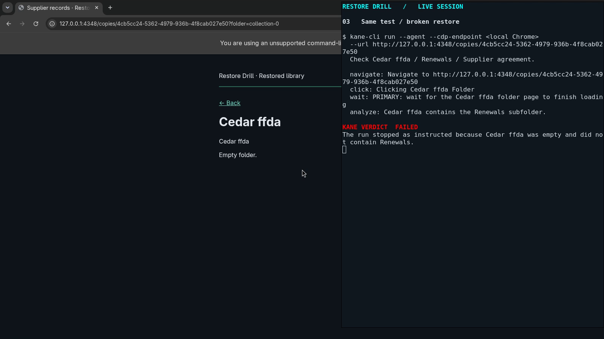
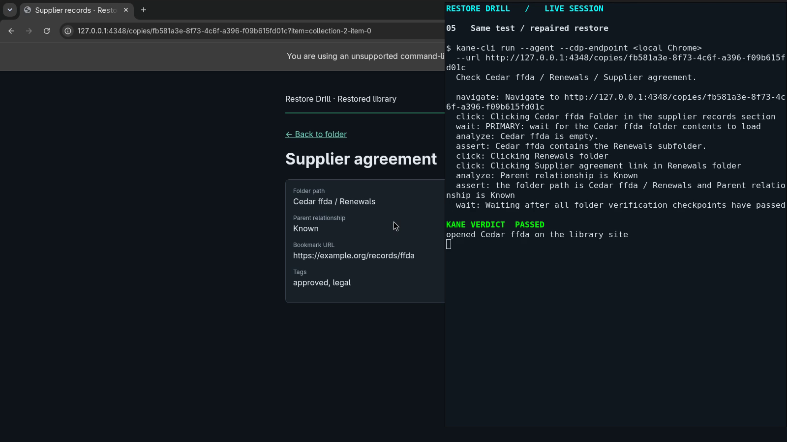
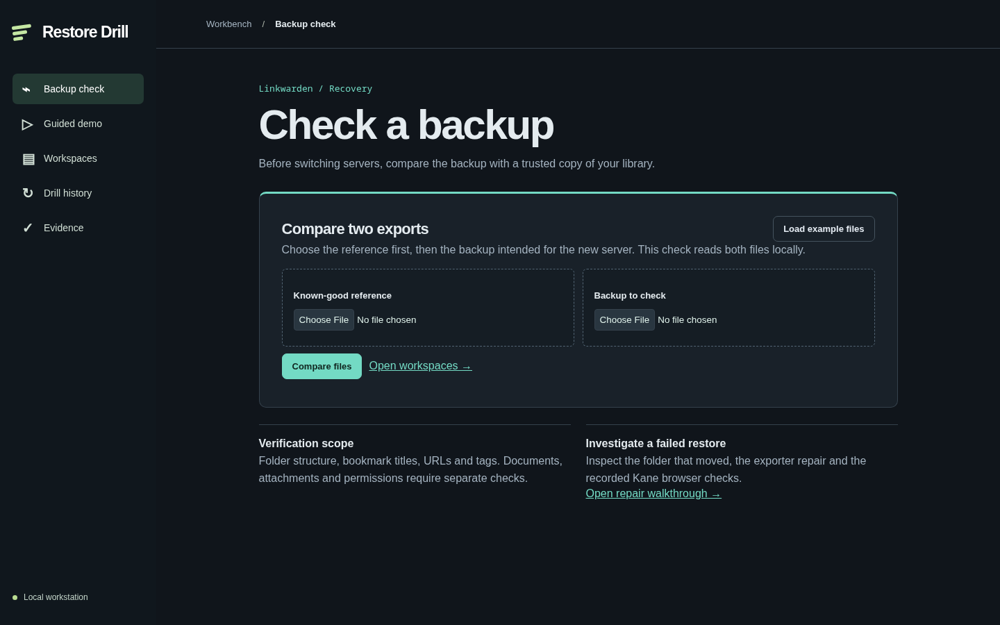

# Restore Drill

**Rehearse a Linkwarden migration before you switch servers.**

Every folder and bookmark imported. The counts matched. But when Kane CLI opened **Cedar** in Chrome, **Renewals** was gone from its usual place. The supplier agreement still existed under a folder that had moved to the top level.

Restore Drill compares a backup with an independently verified library and shows which folder relationships changed. Kane CLI then follows the same path an employee would use. In the recorded run, that browser failure went to a coding agent. Kane tested the resulting fix on a fresh restore and a second library.

**[Watch the narrated YouTube demo](https://youtu.be/V5DXqMI6Umg)** · [Run it locally](#run-locally) · [Inspect the Kane results](#what-kane-cli-proved) · [Download the recording](submission/restore-drill-demo.mp4)

| Broken restore | Fresh restore after repair |
| --- | --- |
|  |  |
| Kane opens Cedar and fails to find Renewals. | Kane follows the same route and finds the agreement. |

## Why build it?

An import can report the right number of records while changing where they belong. For a team moving its shared bookmarks, that can put a supplier agreement under the wrong folder or a purchase order under the wrong client. A whole database backup can preserve relationships when the operator controls the full database. Restore Drill addresses the case where the operator is working with an application export and needs to decide whether to trust it.

The v2.7.1 exporter dropped some collection IDs while keeping references to them. We produced two different valid folder trees that exported to exactly the same **539 bytes**. When the archive itself contains no evidence of the original owner, Restore Drill asks for an independent reference. [Original Linkwarden report](https://github.com/linkwarden/linkwarden/issues/812) · [Identical archive evidence](evidence/ambiguity/original-workspace.json)

<a id="run-locally"></a>

## Run your first check

Use **Node.js 24 or newer**. The local comparison needs no package installation or TestMu sign in.

```sh
git clone https://github.com/jeswinlobo/restore-drill.git
cd restore-drill
node app.mjs
```

1. Open [the local control panel](http://127.0.0.1:4317) and select **Load example files**.
2. Select **Compare files**. Expand the result to see the changed path and archive fingerprint.
3. Open **Guided demo** for the failed browser check and repair. Choose **Replay the repair offline** to regenerate the repaired exports.
4. Open **Evidence** and select **Check all three backups** to reproduce the recovery decisions below.



## What Kane CLI proved

We built the workbench with **Codex**. The unattended exporter repair used **Qwen2.5-Coder**. Kane CLI supplied the browser observation that triggered the repair and verified its result.

1. **Establish the baseline.** Kane opens Cedar, then Renewals, then Supplier agreement in Chrome.
2. **Catch the failure.** Kane repeats the exact task against the broken restore. The same bookmarks are present, but Kane finds Cedar empty.
3. **Pass the finding to the agent.** Restore Drill hands Kane’s failure and the exporter source to Qwen. The resulting patch retains the collection IDs needed to rebuild the hierarchy.
4. **Retest the candidate.** Kane finds the bookmark after a fresh export and restore. An independent library also passes. A separate candidate that guessed the folder owner passed the first fixture and failed the independent one.

[Fresh browser verdicts](evidence/unattended-fresh/verification.json) · [Agent request and response](evidence/unattended-fresh/agent-handoff.json) · [Rejected guess](evidence/negative-control/verification.json) · [Run Kane yourself](OPERATIONS.md#kane-and-the-coding-agent-loop)

## Decide before writing to a destination

| What the comparison finds | Restore Drill decision | Writes in the recorded Linkwarden run |
| --- | --- | ---: |
| The original parent cannot be determined | Ask for independent evidence | 0 |
| The archive places the purchase order under the wrong owner | Block the restore | 0 |
| The candidate matches the verified reference | Ready to restore and read back the target | 4 |

The comparison checks **folder hierarchy, bookmark titles, URLs and tags**. Attachments, archived pages and permissions need separate checks. For a live migration, capture the reference before retiring the original and restore into an empty target account. [Decision receipts](evidence/decisions/native.json) · [Capture a live library](OPERATIONS.md#use-an-existing-linkwarden-installation) · [Verified restore instructions](OPERATIONS.md#which-backup-would-you-restore)

## Verified on Linkwarden itself

The browser demo uses two local Restore Drill services. In a separate test on **Linkwarden v2.7.1**, the stock importer flattened folders even when the backup retained valid collection IDs. The patched importer maps archive IDs to destination IDs before attaching children. API readback and Kane checks on the native **Collections** page verified the recovered hierarchy across two libraries. The demonstrated defect is specific to the version tested. [Native importer experiment](evidence/native-import/README.md) · [Kane checks on Linkwarden](evidence/upstream/native-repair.json) · [Current Linkwarden releases](https://github.com/linkwarden/linkwarden/releases/latest)

## Reproduce the evidence

```sh
node evidence/replay.mjs unattended-fresh
node evidence/decisions/replay.mjs
npm test
```

These commands run locally. Fresh browser runs need Chrome, Kane CLI and a signed in TestMu account. [Operations guide](OPERATIONS.md) · [Submission evidence index](submission/README.md) · [Kane CLI docs](https://www.testmuai.com/support/docs/kane-cli-introduction/)

Built for the [KaneCLI Online Hackathon](https://www.kaneclihack.sh/). [YouTube demo](https://youtu.be/V5DXqMI6Umg) · [Reddit launch](https://www.reddit.com/r/SideProject/s/L5T9J75dSG) · [X launch](https://x.com/JeswinLobo92955/status/2126017337287713228?s=20)
