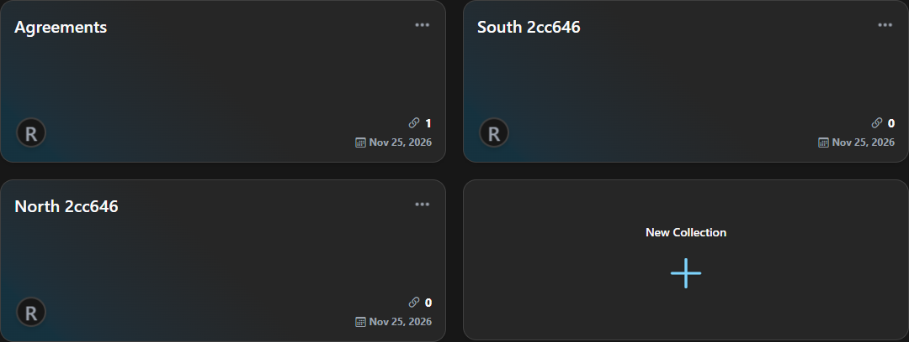
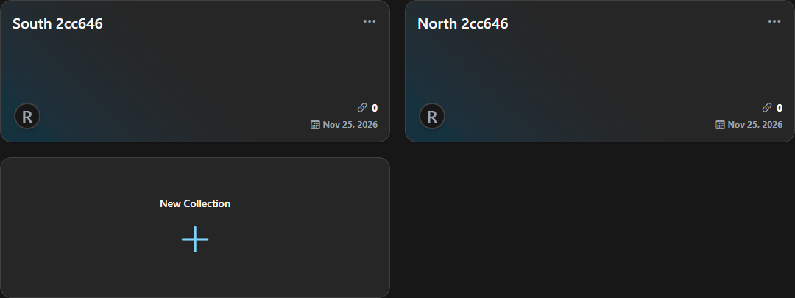

# Restore Drill

Can someone still find the signed contract after restoring a backup? Restore Drill follows a bookmark from its owner's folder to its saved URL, then repeats that journey on a fresh restore. When a parent is lost, Kane checks the failure in Chrome and a coding agent can repair the exporter.

[Watch the walkthrough](submission/restore-drill-evidence-walkthrough.mp4) · [Read the captions](submission/restore-drill-evidence-captions.vtt) · [Run locally](#run-locally)

The app opens on **Restore comparison**. Explore the original and broken folder trees, trace the coding-agent repair, inspect Kane’s recorded retest, and rerun the archive decisions. Under **Decide what to restore**, compare your own backup against a known-good export without writing to the library. The guided demo runs without an account. Use **Workspaces** for your own library or see the [guided demo plan](submission/guided-demo.md) for verification and the separate recording.

In two independent Linkwarden v2.7.1 installations, a stock migration preserved all three folders, the bookmark and both tags. It moved the agreement out of its owner's folder. Kane spotted the extra top-level collection on Linkwarden's own screen. Restore Drill recovered the expected path through the public API and Kane passed the same check. [Migration report](https://github.com/linkwarden/linkwarden/issues/812) · [Upstream API measurements](evidence/upstream/pair.json) · [Native browser verdicts](evidence/upstream/native-kane.json)

| Stock migration | Restore Drill recovery |
| --- | --- |
|  |  |
| The owner and Agreements appear side by side. | Agreements is back inside South 2cc646. |

The original exporter removes collection IDs that its parent references need. In the recorded library, two different owners produced exactly the same 539 archive bytes. The workbench can test this on your own known source. Some archives retain usable identifiers on their links, and Restore Drill uses those when they agree. [Published exporter](https://github.com/linkwarden/linkwarden/blob/v2.7.1/lib/api/controllers/migration/exportData.ts) · [Identical-archive proof](evidence/ambiguity/original-workspace.json)

## Repairing Linkwarden's native migration

Two frozen libraries flattened under stock Linkwarden v2.7.1. After applying a local importer patch, Linkwarden's native migration preserved all nine folders and three bookmarks across the two libraries. Kane passed the original browser objective on both. An independent API readback also checked the full hierarchy, including duplicate collection names, duplicate bookmark titles and an empty nested folder. [Experiment, exact diff and replay](evidence/native-import/README.md)

## Which backup would you restore?

Three exports of one purchase order contain the same number of folders and bookmarks. Only one preserves its owner. In the workbench, open **Evidence → Check all three backups**, or run this offline with Node 24.

```sh
node evidence/decisions/replay.mjs
```

| What the archive says | Decision against the independent source | Writes observed on Linkwarden v2.7.1 |
| --- | --- | --- |
| The parent ID points to an unidentified folder | Ask for evidence | 0 |
| Studio owns the order, but the source says Lab | Block recovery | 0 |
| Lab owns the order, matching the source | Restore and read back the target | 4 (three folders and one bookmark) |

The replay computes the decisions from the original JSON bytes and checks them against the recorded API observations. It also checks the wrong-owner and repaired fingerprints against earlier Kane holdout runs. To repeat the writes on your own local Linkwarden instance, run `node integrations/upstream/check-recovery-decision.mjs --target http://localhost:3001 --create-disposable-account`. This creates a new account on a loopback instance with registration enabled. [Native run](evidence/decisions/native.json)

For your own backup, capture a known-good source while it is available, or open an independently verified workspace and choose **Check a backup before restoring**. A future recovery can use the saved capture after the source goes offline. These checks cover folder hierarchy and bookmark title, URL and tags.

```sh
node cli.mjs assess-recovery known-good.json backup.json
node cli.mjs restore-verified known-good.json backup.json --target http://localhost:3001 --write-to-empty-target
```

The second command uses `LINKWARDEN_TARGET_TOKEN` and requires an empty account. It records acknowledged writes, reads back the target, and exits unsuccessfully if the target disagrees. A partial write leaves a journal in the printed directory. Use a fresh target for a retry.

## Run locally

Requires Node.js **24 or newer**. The workbench has zero third-party runtime dependencies. From this directory run:

```sh
node app.mjs
```

Open **http://127.0.0.1:4317**. Windows users can also open **Start Restore Drill.cmd**. On the original workstation, the local launcher uses the existing Codex-bundled Node runtime. On another computer install Node 24+. No external account is needed for archive inspection or local comparison.

Open **Evidence** to inspect the browser verdicts. Choose **Reproduce archive comparison** to execute a recorded repair on two libraries and compare the new archive fingerprints with the old ones. **Open a copy of this workspace** creates an editable local copy of the source used for the ambiguity check. These actions work without a TestMu account. From a terminal, `node evidence/replay.mjs` reproduces the reviewed repair. [Recorded materials](submission/README.md)

### Your first drill

1. Create a workspace. Add two root folders and one child under either root. Put a bookmark in the child. Pick your own names and URL. Leave the parent without direct bookmarks to exercise the historical exporter's lost-ID case.
2. Choose **Run restore drill**. **Fresh portable export** creates a baseline round trip. **Linkwarden v2.7.1 export controller** downloads the official, pinned controller on first use and executes it against your workspace's data. **Upload a candidate archive** accepts an existing file. Each restore creates a separate, immutable destination copy.
3. Open the source and restored libraries. Compare the actual paths, counts, titles, URLs and tag sets. The two pages run on different local ports. **Download report** saves the comparison and observed browser verdicts.
4. Choose **Reference-preserving bookmark controller** for a new export that assigns portable folder identifiers. Recheck the old bytes with **Upload a candidate archive**. Historic archives stay unchanged. If you independently know a missing parent, import the archive as a working workspace and use **Confirm parent** there.
5. Change the parent, title or tags using **Edit**. New drills use the edited revision. Earlier drill reports retain the original snapshot.
6. Choose **Test archive ambiguity** to compare two valid source layouts. On a suitable library the app runs both exporters twice and shows the bookmark's two possible paths, whether the historical bytes match, and whether both portable restores succeed. It explains when a library lacks a suitable pair of roots. The CLI equivalent is `node cli.mjs ambiguity source.json`.

## Kane and the coding-agent loop

Install Chrome and Kane CLI, and sign in to Kane. For automated repair, choose Codex CLI or the local model described below.

```sh
npm install -g @testmuai/kane-cli
kane-cli login --oauth
node cli.mjs doctor
```

On the original Windows workstation, Kane is already installed in local tooling. Use `Start Restore Drill.cmd login` to sign in. `Start Restore Drill.cmd doctor` prints availability without exposing account tokens. Kane checks use your TestMu account and credits. Use data appropriate to send to TestMu. An optional Codex repair sends the controller source and failed observation to the coding agent.

From a workspace, choose **Start rehearsal** and select a real bookmark. Choose **Verify, send the failure to the coding agent and rerun** to enable repair. Select a second workspace and bookmark for an independent check, then leave the workbench running. The default agent is Codex CLI. An optional local coding model can also produce a repair.

- Restore Drill freezes the source revision and the bookmark objective, executes the exporter, and imports the resulting archive into its own read-only destination service.
- Kane opens the source, follows the folder sequence and inspects the bookmark details. If that succeeds, its source URL returns HTTP 410 while Kane repeats the task on the destination. The verifier never opens the saved external URL.
- A confirmed Kane product failure and a matching archive discrepancy trigger repair. When Kane disputes a navigation task, a uniquely identifiable bookmark can receive a separate positive check of its actual details. The verifier records whether it saw an unknown parent or a different known path. The original route verdict remains in the report. Timeouts, authentication errors and failed source checks remain inconclusive.
- Codex can propose a complete TypeScript replacement in a read-only session. The optional local agent generates an edit under constraints derived from the failed archive. For the recorded ID-redaction failure, the workbench localized the deletion and the model generated its guard. The workbench executes proposed controllers in a separate Node process with restricted file access, a minimal environment and a time limit. Candidates stay in the rehearsal directory. [Local agent setup](integrations/local-agent/README.md)
- Up to two agent attempts are permitted. Each attempt creates a new export and destination using the same frozen task. A changed source revision stops the run. A selected holdout must also pass. Finally, the original archive bytes are restored again and their fingerprint checked.
- Open **Drill history → Exporter rehearsals** for the stages, associated drills and downloadable candidate. Raw Kane NDJSON, stderr, prompts, source versions and reports stay in the private data directory.

The fast workbench rehearsal runs the historical controller against a Prisma read adapter and checks Restore Drill's browser views. The upstream integration separately executes the candidate against real Prisma and PostgreSQL and tests native Linkwarden accounts. Both flows cover bookmark metadata and folder ownership. Attachments, permissions and archived pages are outside the recovery scope.

### Resume a repair from saved evidence

When a coding-agent process stops, the confirmed browser result can be reused. Continue the same CLI rehearsal with `--repair --resume PRIOR_RUN`. Restore Drill checks the source revision, holdout, controller, objective and original archive fingerprint against the recorded failure before continuing. Fresh browser checks still run on the candidate.

For a repair reviewed in a coding-agent chat, use the saved `repair-1/prompt.txt` as input. Save the response as JSON with two strings named `source` and `explanation`. Append `--proposal PATH_TO_RESPONSE.json` to the resume command. The report records this delivery method. This path also works when a managed desktop restricts nested Codex processes.

Kane usually starts its own Chrome instance. If an environment already provides a dedicated local Chrome debugging endpoint, set `RESTORE_DRILL_CDP_ENDPOINT` to its loopback HTTP origin. Use a disposable Chrome profile for the rehearsal.

## Use an existing Linkwarden installation

Use two instances you control. Supply bearer tokens through `LINKWARDEN_SOURCE_TOKEN` and `LINKWARDEN_TARGET_TOKEN`. Non-loopback URLs require HTTPS. A capture pages through the collections and links twice and checks for changes. An optional `--owner-id` filters the known baseline to collections owned by the specified account.

```sh
node cli.mjs capture http://localhost:3000 source.json
node cli.mjs import source.json --name "My Linkwarden library"
node cli.mjs inspect backup.json
node cli.mjs compare source.json backup.json
```

To exercise Linkwarden's own migration endpoint against an **empty disposable target account**:

```sh
node cli.mjs live --source http://localhost:3000 --target http://localhost:3001 --write-to-empty-target
```

To restore a portable archive through Linkwarden's collection and link APIs, preserving known relationships:

```sh
node cli.mjs restore-into source.json --target http://localhost:3001 --write-to-empty-target
```

The second command creates parents before children, maps new target IDs, journals acknowledged creations and captures the target again. Unknown parentage stops it before the first write. Both commands require an empty account. If a remote service fails partway, inspect the journal and use a fresh account for the next attempt. The v2.7.1 stock importer also drops parentage when given the repaired export. The mapped restore is what preserves the hierarchy in the target application. [Two-instance runner](integrations/upstream/run-pair.mjs) · [Real Prisma and importer results](evidence/upstream/candidate.json)

## CLI and data

```sh
node cli.mjs help
node cli.mjs workspaces
node cli.mjs workspace WORKSPACE_ID
node cli.mjs rehearse WORKSPACE_ID --item BOOKMARK_ID --repair --holdout OTHER_WORKSPACE_ID --holdout-item OTHER_BOOKMARK_ID
node cli.mjs rehearse WORKSPACE_ID --item BOOKMARK_ID --local-only --exporter integrations/linkwarden/bookmark-export.ts
node --test "test/*.test.mjs"
```

Use `--data PATH` on the CLI or server to select a different private store. A rehearsal runs only a trusted local controller or the pinned upstream source. `RESTORE_DRILL_KANE` and `RESTORE_DRILL_CODEX` can point to local executables or JavaScript CLI entry points. The official download is verified against Git's v2.7.1 blob ID before execution and cached for offline reuse.

| Location | Contents |
| --- | --- |
| `.restore-drill/source.sqlite` | Editable libraries, frozen source snapshots, candidate archive bytes, comparisons and browser observation summaries |
| `.restore-drill/restored.sqlite` | Destination copies, read through a separate process with a read-only SQLite connection |
| `.restore-drill/evidence/<drill>/<observation>/` | Frozen objective and raw source/destination Kane outputs |
| `.restore-drill/rehearsals/<run>/` | Controller revisions, agent handoff, holdout outcome and original-archive replay |
| `.restore-drill/live/` | Local records of external Linkwarden migrations and restores |

The workspace and destination writes for a comparison share one SQLite transaction. Updated workspaces use optimistic revision checks. Comparisons preserve duplicate counts and check subtree contents even when sibling names repeat. A browser witness requires a path that can be unambiguously navigated by its folder names. The format accepts HTTP(S) bookmarks, up to 50,000 folders and bookmarks each, a maximum nesting depth of 128, and uploads up to 16 MiB. Private data, credentials and machine-specific paths are gitignored.

## Evidence and submission

**Fresh end-to-end run.** One command started with the historical exporter, two newly named libraries and the locally installed model. Kane caught the lost path to the supplier agreement. The model started on demand and generated a guard. Kane passed the repaired source and destination, then the inspection record in a different owner's library. All six browser observations came from this run. Replaying the original bytes still required review. Try `node evidence/replay.mjs unattended-fresh` without an account. [Fresh Kane verdicts](evidence/unattended-fresh/verification.json) · [Model fingerprint and response](evidence/unattended-fresh/agent-handoff.json)

**Unattended repair.** After a confirmed Kane browser failure, Qwen2.5-Coder generated a collection check for the export controller. The program applied the edit. Kane passed the restored bookmark path on the source fixture and on an independent library. The original archive still required review. This run resumed the frozen original failure and used four new authenticated browser checks. To reproduce its archive results offline, run `node evidence/replay.mjs unattended`. The generated patch preserves collection database IDs. The bookmark-only controller supplied in the workbench uses archive-local IDs. [Kane checks](evidence/unattended/verification.json) · [Exact model request and response](evidence/unattended/agent-handoff.json) · [Earlier rejected edits](evidence/unattended/rejected-edits.json) · [Real database test](evidence/upstream/unattended-candidate.json)

**Upstream production check.** Two production builds of Linkwarden v2.7.1 used separate PostgreSQL databases. Six folders included a three-level path, an empty folder and two identically named folders. Two bookmarks shared a title. The stock migration flattened both paths. Restore Drill verified all eight writes and recovered both routes. [Results](evidence/upstream/production-branching.json) · [Repeat the upstream checks](integrations/upstream/README.md) · [Repeat the native Kane checks](integrations/upstream/native-browser.md)

**Follow the same repair into the real application.** We supplied the exact 563 bytes from the unattended repair to two fresh production accounts. Linkwarden's stock importer flattened the hierarchy. Restore Drill's mapped restore preserved it. Kane inspected the same Collections grid objective on the source and both targets and returned pass, confirmed product bug, pass. Each account's contents were unchanged after inspection. You can export a completed rehearsal and run this check on your own recovery evidence. [Native checks and archive fingerprints](evidence/upstream/native-repair.json) · [Export a rehearsal](evidence/README.md)

On 25 November 2026, signed-in Kane CLI 0.10.9 passed the source path and classified the historical restore as a confirmed product bug. The Codex desktop session received that finding and supplied a changed exporter. Kane passed both the original and restored paths for the repaired workspace, then passed both paths on an independent workspace. Replaying the original bytes still produced an unresolved parent. The machine's nested CLI process encountered a Windows permission error, so the recorded run used the reviewed-agent response option. [Six browser verdicts](evidence/kane/verification.json) · [Agent handoff](evidence/kane/agent-handoff.json) · [Candidate controller](evidence/kane/repair-1-candidate.ts)

One deliberately wrong exporter guesses the first root. It passed both original browser checks. On the second workspace, Kane confirmed a product bug after the owner could no longer reach the purchase order. Run `npm run challenge` to reproduce seven local archive comparisons. The recorded reviewed repair passed seven. The guess passed three. Use `node evidence/challenge.mjs --candidate controller.ts` to try another controller on the two recorded and five generated cases. [Four live control verdicts](evidence/negative-control/verification.json) · [Seven-case comparison](evidence/challenge/result.json)

The automated tests use protocol doubles for paid services. The recorded Kane runs used a signed-in account. [Independent Chrome checks](evidence/chromium) · [Walkthrough, captions and submission notes](submission/README.md) · [Event brief](https://www.kaneclihack.sh/) · [Kane agent interface](https://www.testmuai.com/kane-cli/agents/)

Kane labels the first flow within each invocation `run-0`. In the public receipts, the timestamp and SHA-256 of the raw event stream distinguish invocations. An original failure reused by a resumed rehearsal retains the same stream fingerprint. Private data directories retain service output for the account holder.
